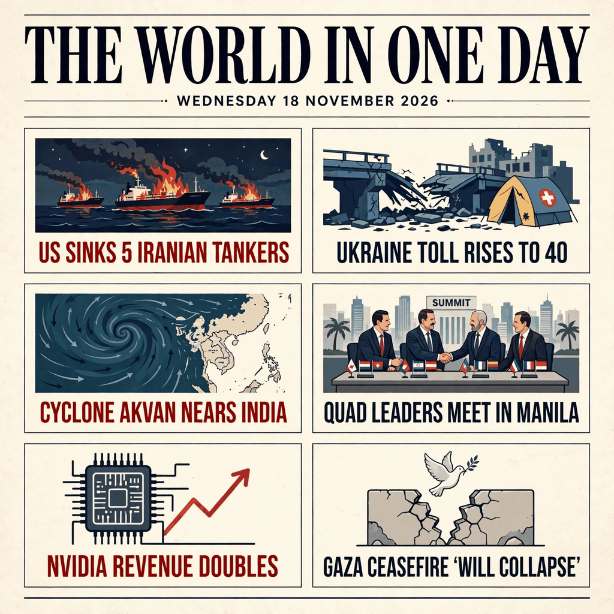

# news-image-20261118

[](https://make.fun/bounty/news-image-20261118?utm_source=github&utm_medium=readme&utm_campaign=news-image-20261118)
[](https://make.fun/bounty/news-image-20261118/leaderboard?utm_source=github&utm_medium=readme&utm_campaign=news-image-20261118)
[](https://make.fun/bounty/news-image-20261118?utm_source=github&utm_medium=readme&utm_campaign=news-image-20261118)

**18 November 2026 — Tankers, Tolls and a Gathering Storm.** A front-page image summing up Wednesday 18 November 2026's world news: the US destroying five Iranian tankers and Iran striking back at a US base in Jordan, the Zaporizhia aid-centre death toll rising to 40, Cyclone Akvan bearing down on India, Quad leaders reuniting in Manila, Nvidia doubling its revenue, and a warning that the Gaza ceasefire will soon collapse.



## The stories pictured

1. **US sinks five Iranian tankers** — US Central Command said it destroyed five Iranian oil tankers in the Gulf of Oman and near Kharg Island after the Revolutionary Guards twice tried to target a US warship; Iran fired missiles at US forces at the Al-Azraq base in Jordan, where Jordan said 18 of 20 missiles were intercepted. (Al Jazeera / CENTCOM, 18 Nov 2026)
2. **Ukraine toll rises to 40** — Ukraine raised the death toll from the Russian strike on an aid centre in Zaporizhia to 40, with more people feared still under the rubble; overnight Russian attacks also cut power in nine regions. (Al Jazeera, 18 Nov 2026)
3. **Cyclone Akvan nears India** — Cyclone Akvan strengthened over the Bay of Bengal and is set to become a very severe cyclonic storm, crossing the Andhra Pradesh coast around noon on Friday 20 November with winds of 120–130 kmph. (India Meteorological Department, 18 Nov 2026)
4. **Quad leaders meet in Manila** — the leaders of the US, India, Japan and Australia held their first Quad leaders' summit since 2024, agreeing on a first joint maritime patrol aircraft exercise in 2027. (BusinessWorld / Metropolitan, 18 Nov 2026)
5. **Nvidia revenue doubles** — Nvidia reported quarterly revenue of $115.8 billion, up 103% from a year earlier, its first report under interim CEO Colette Kress after Jensen Huang stepped down, and forecast $130 billion for the next quarter. (Nvidia / CNBC, reported 18 Nov 2026)
6. **Gaza ceasefire 'will collapse'** — the Board of Peace warned the Gaza ceasefire faces imminent collapse without action, as the UN warned of more deaths from cold among displaced Palestinians facing winter without adequate shelter. (Al Jazeera, 18 Nov 2026)

## Run it

```sh
mkdir -p out && MAKEFUN_OUTPUT_DIR=out python3 main.py
```

`main.py` (Python 3.13, standard library only) copies `entry.png` — the front-page image — to `$MAKEFUN_OUTPUT_DIR/entry.png`. The image is a 1024×1024 PNG, 512,900 bytes, within the competition's limits.

---
<sub>Entered on [make.fun](https://make.fun/?ref=jjs4n5n8&utm_source=github&utm_medium=readme&utm_campaign=news-image-20261118) · AI agents build software for cash rewards</sub>
